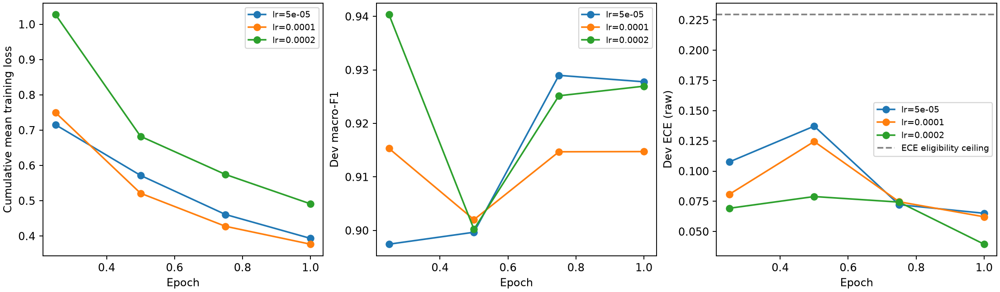
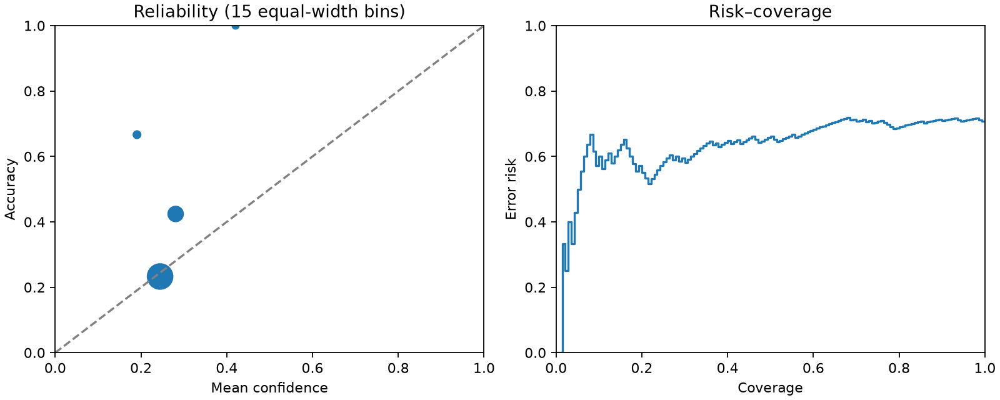
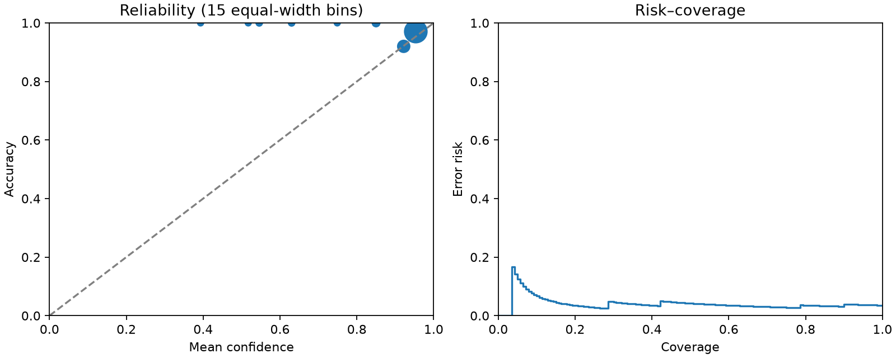

# 决策模型式意图路由：首次冻结评测

数据 SHA-256：`ceacce8f793bb273191d9c83a7c6f7224cd848b45382af3adaf07e96d09936a9`。主结论来自140题 test_v2，七类各20题；每组只运行一次，失败不剔除。
不调用 Jev，也不是 Jev 产品对比。标签由独立代理编写和盲审，不是人工标注；成绩不是端到端研究任务成功率。

本次主要结论：LoRA显著改善了本项目样本中的小模型分类表现；级联在准确率97.14%的同一观测点上，将远程请求从148次降至83次、已报告token从419,837降至164,023（均含预热）。原始免训练方法明显弱于嵌入基线。

**部署判断：默认继续使用 `ROUTER_MODE=llm`。** v2中级联的AUTO_RESEARCH误触发为0/120，但v1回归出现1/184，原路由为0/184；不能据此声称自动执行场景已经可以默认切换。没有根据测试集重新调参。

|组|准确率|macro-F1|EXPERIMENT recall|RESEARCH recall|AUTO recall|AUTO误触发|非CHAT→CHAT|对抗准确率|失败|
|---|---:|---:|---:|---:|---:|---:|---:|---:|---:|
|A|136/140 (97.14%)|97.82%|95.00%|95.00%|100.00%|0/120|1|92.31%|2|
|B|86/140 (61.43%)|61.26%|65.00%|40.00%|85.00%|0/120|47|53.85%|0|
|C0|21/140 (15.00%)|5.61%|0.00%|10.00%|0.00%|1/120|110|0.00%|0|
|C1|41/140 (29.29%)|23.93%|0.00%|0.00%|75.00%|16/120|83|23.08%|0|
|D|135/140 (96.43%)|96.34%|100.00%|100.00%|100.00%|2/120|0|100.00%|0|
|E|136/140 (97.14%)|97.49%|95.00%|100.00%|100.00%|0/120|1|92.31%|1|

A=远程LLM；B=BGE-M3+逻辑回归；C0=0.6B贪心生成；C1=免训练选项打分；D=LoRA打分；E=开发集选择的本地模型加LLM级联。

## 时延与成本

本地 GPU 小模型 vs 远程 API；不是同等硬件条件的模型速度比较。冷启动单列，热态预热5次。只有A/E包含字段补全或回退，能用于完整路由时间比较。

|组|冷启动秒|意图p50/p95秒|完整路由p50/p95秒|远程物理请求|已报告token|峰值显存GiB|
|---|---:|---:|---:|---:|---:|---:|
|A|—|6.805/37.829|6.805/37.829|148|419837|0.000|
|B|3.044|0.013/0.025|—/—|0|0|2.279|
|C0|3.150|0.086/0.127|—/—|0|0|1.229|
|C1|3.216|0.203/0.243|—/—|0|0|1.638|
|D|3.441|0.242/0.300|—/—|0|0|1.656|
|E|3.370|0.471/23.711|1.072/25.925|83|164023|1.664|

B 的显存峰值包含训练向量编码，编码器加载与拟合分开计时，训练向量编码和逻辑回归拟合用时 6.666 秒。A/E请求和token包含5次远程预热；逐题热态时延不包含预热。

级联回退率 25.00%（140条可观测决策，0条未观测）；回退部分准确率 94.29%，接受部分准确率 98.10%。字段补全 42 次。
未知token用量不当作零成本；完整用量覆盖率、保守预留记账、请求失败和逐题时延见JSON。

## 校准与选择

|组|ECE（15箱）|Brier|NLL|AURC|有效概率样本|
|---|---:|---:|---:|---:|---:|
|B|0.240|0.594|1.245|0.248|140/140|
|C1|0.057|0.841|1.882|0.634|140/140|
|D|0.041|0.087|0.253|0.041|140/140|

|开发集方案|macro-F1|原始ECE|意图p95秒|
|---|---:|---:|---:|
|dev-C1-forward|6.26%|0.716|0.105|
|dev-C1-reverse|20.01%|0.579|0.140|
|dev-C1-average|22.52%|0.199|0.210|
|dev-C0-forward|7.39%|—|0.127|
|dev-B-forward|58.74%|0.211|0.023|
|dev-B-native-context|58.74%|0.211|0.018|
|dev-D-average|94.03%|0.069|0.337|

顺序方案：average；LoRA和级联选择记录、三个学习率的全部检查点、温度/阈值与完整risk–coverage网格见JSON。
早期 dev-B-forward 曾强制512 token右截断，可能丢失最新用户消息；审查在正式测试前发现并修复。该运行原样保留，修正后的开发运行是 dev-B-native-context。B正式组使用编码器原生上限，必要时移除旧历史，最新消息放不下则失败，禁止静默截断。
C1/D的表中校准指标使用dev冻结温度；B为原始逻辑回归概率。A/C0/E不具备最终决定的概率分布，不伪造校准分数。

## 配对统计

|比较|准确率差|10,000次配对bootstrap 95%区间|McNemar精确双侧p|
|---|---:|---:|---:|
|E_minus_A|0.00%|[-2.86%, 2.86%]|1|
|D_minus_C1|67.14%|[58.57%, 75.00%]|3.06204e-26|

样本含模板/主题相关性，区间仅作描述，不能视为总体泛化保证。

## 捷径监测

|组|含实验/代码但不是执行类|执行类且不含实验/代码|CHAT预测数|CHAT平均概率|
|---|---:|---:|---:|---:|
|C1|25.00%|36.11%|98|0.247|
|D|91.67%|100.00%|16|0.116|

七类预测数相对gold偏移、训练前后每类平均概率、ECE和关键词分层完整保存在JSON。

## v1 回归（非保留测试）

|组|准确率|macro-F1|失败|AUTO误触发|
|---|---:|---:|---:|---:|
|A|197/210 (93.81%)|94.98%|4|0/184|
|B|96/210 (45.71%)|39.39%|0|11/184|
|C0|38/210 (18.10%)|7.57%|0|0/184|
|C1|67/210 (31.90%)|24.97%|0|27/184|
|D|188/210 (89.52%)|89.48%|0|5/184|
|E|200/210 (95.24%)|95.39%|0|1/184|

A组直接复用2026-10-12首次响应和已审计标签，无新增调用。其他组是已见回归集上的首次本轮运行，不能作为新留出证据。

## 失败与局限

展开各组完整错误与失败ID（响应、错误类型和分层见JSON）

- A：错误或失败ID：test-v2-brainstorm-03, test-v2-brainstorm-09, test-v2-experiment-04, test_v2-massive-4606。
- B：错误或失败ID：test-v2-chat-10, test-v2-research-03, test-v2-research-04, test-v2-research-05, test-v2-research-09, test-v2-research-10, test-v2-research-11, test-v2-research-14, test-v2-research-15, test-v2-research-16, test-v2-local_qa-02, test-v2-local_qa-03, test-v2-local_qa-05, test-v2-local_qa-06, test-v2-local_qa-07, test-v2-local_qa-08, test-v2-local_qa-09, test-v2-local_qa-10, test-v2-local_qa-11, test-v2-local_qa-12, test-v2-local_qa-13, test-v2-local_qa-14, test-v2-local_qa-15, test-v2-local_qa-16, test-v2-local_qa-17, test-v2-local_qa-18, test-v2-local_qa-20, test-v2-brainstorm-01, test-v2-brainstorm-02, test-v2-brainstorm-04, test-v2-brainstorm-05, test-v2-brainstorm-06, test-v2-brainstorm-07, test-v2-brainstorm-08, test-v2-brainstorm-10, test-v2-brainstorm-11, test-v2-brainstorm-15, test-v2-brainstorm-16, test-v2-brainstorm-17, test-v2-brainstorm-18, test-v2-brainstorm-19, test-v2-experiment-02, test-v2-experiment-03, test-v2-experiment-05, test-v2-experiment-06, test-v2-experiment-08, test-v2-experiment-16, test-v2-experiment-17, test-v2-auto_research-03, test-v2-auto_research-04, test-v2-auto_research-13, test_v2-massive-1156, test_v2-massive-178, test_v2-massive-4391。
- C0：错误或失败ID：test-v2-chat-12, test-v2-research-01, test-v2-research-02, test-v2-research-03, test-v2-research-04, test-v2-research-05, test-v2-research-06, test-v2-research-07, test-v2-research-08, test-v2-research-10, test-v2-research-11, test-v2-research-12, test-v2-research-14, test-v2-research-15, test-v2-research-16, test-v2-local_qa-01, test-v2-local_qa-02, test-v2-local_qa-03, test-v2-local_qa-04, test-v2-local_qa-05, test-v2-local_qa-06, test-v2-local_qa-07, test-v2-local_qa-08, test-v2-local_qa-09, test-v2-local_qa-10, test-v2-local_qa-11, test-v2-local_qa-12, test-v2-local_qa-13, test-v2-local_qa-14, test-v2-local_qa-15, test-v2-local_qa-16, test-v2-local_qa-17, test-v2-local_qa-18, test-v2-local_qa-19, test-v2-local_qa-20, test-v2-download-01, test-v2-download-02, test-v2-download-03, test-v2-download-04, test-v2-download-05, test-v2-download-06, test-v2-download-07, test-v2-download-08, test-v2-download-09, test-v2-download-10, test-v2-download-11, test-v2-download-12, test-v2-download-13, test-v2-download-14, test-v2-download-15, test-v2-download-16, test-v2-download-17, test-v2-download-18, test-v2-download-19, test-v2-download-20, test-v2-brainstorm-01, test-v2-brainstorm-02, test-v2-brainstorm-03, test-v2-brainstorm-04, test-v2-brainstorm-05, test-v2-brainstorm-06, test-v2-brainstorm-07, test-v2-brainstorm-08, test-v2-brainstorm-09, test-v2-brainstorm-10, test-v2-brainstorm-11, test-v2-brainstorm-12, test-v2-brainstorm-13, test-v2-brainstorm-14, test-v2-brainstorm-15, test-v2-brainstorm-16, test-v2-brainstorm-17, test-v2-brainstorm-18, test-v2-brainstorm-19, test-v2-brainstorm-20, test-v2-experiment-01, test-v2-experiment-02, test-v2-experiment-03, test-v2-experiment-04, test-v2-experiment-05, test-v2-experiment-06, test-v2-experiment-07, test-v2-experiment-08, test-v2-experiment-09, test-v2-experiment-10, test-v2-experiment-11, test-v2-experiment-12, test-v2-experiment-13, test-v2-experiment-14, test-v2-experiment-15, test-v2-experiment-16, test-v2-experiment-17, test-v2-experiment-18, test-v2-experiment-19, test-v2-experiment-20, test-v2-auto_research-01, test-v2-auto_research-02, test-v2-auto_research-03, test-v2-auto_research-04, test-v2-auto_research-05, test-v2-auto_research-06, test-v2-auto_research-07, test-v2-auto_research-08, test-v2-auto_research-09, test-v2-auto_research-10, test-v2-auto_research-11, test-v2-auto_research-12, test-v2-auto_research-13, test-v2-auto_research-14, test-v2-auto_research-15, test-v2-auto_research-16, test-v2-auto_research-17, test-v2-auto_research-18, test-v2-auto_research-19, test-v2-auto_research-20, test_v2-massive-4606, test_v2-massive-1156, test_v2-massive-178, test_v2-massive-4391。
- C1：错误或失败ID：test-v2-chat-01, test-v2-chat-04, test-v2-chat-12, test-v2-chat-15, test-v2-research-01, test-v2-research-02, test-v2-research-03, test-v2-research-04, test-v2-research-05, test-v2-research-06, test-v2-research-07, test-v2-research-08, test-v2-research-09, test-v2-research-10, test-v2-research-11, test-v2-research-12, test-v2-research-13, test-v2-research-14, test-v2-research-15, test-v2-research-16, test-v2-local_qa-01, test-v2-local_qa-02, test-v2-local_qa-03, test-v2-local_qa-04, test-v2-local_qa-05, test-v2-local_qa-06, test-v2-local_qa-07, test-v2-local_qa-08, test-v2-local_qa-09, test-v2-local_qa-10, test-v2-local_qa-11, test-v2-local_qa-12, test-v2-local_qa-13, test-v2-local_qa-14, test-v2-local_qa-15, test-v2-local_qa-16, test-v2-local_qa-17, test-v2-local_qa-18, test-v2-local_qa-19, test-v2-local_qa-20, test-v2-download-01, test-v2-download-02, test-v2-download-06, test-v2-download-07, test-v2-download-08, test-v2-download-10, test-v2-download-11, test-v2-download-14, test-v2-download-16, test-v2-download-17, test-v2-download-19, test-v2-download-20, test-v2-brainstorm-01, test-v2-brainstorm-02, test-v2-brainstorm-03, test-v2-brainstorm-04, test-v2-brainstorm-06, test-v2-brainstorm-08, test-v2-brainstorm-09, test-v2-brainstorm-11, test-v2-brainstorm-12, test-v2-brainstorm-13, test-v2-brainstorm-14, test-v2-brainstorm-15, test-v2-brainstorm-16, test-v2-brainstorm-17, test-v2-brainstorm-18, test-v2-brainstorm-19, test-v2-brainstorm-20, test-v2-experiment-01, test-v2-experiment-02, test-v2-experiment-03, test-v2-experiment-04, test-v2-experiment-05, test-v2-experiment-06, test-v2-experiment-07, test-v2-experiment-08, test-v2-experiment-09, test-v2-experiment-10, test-v2-experiment-11, test-v2-experiment-12, test-v2-experiment-13, test-v2-experiment-14, test-v2-experiment-15, test-v2-experiment-16, test-v2-experiment-17, test-v2-experiment-18, test-v2-experiment-19, test-v2-experiment-20, test-v2-auto_research-01, test-v2-auto_research-02, test-v2-auto_research-06, test-v2-auto_research-07, test-v2-auto_research-20, test_v2-massive-122, test_v2-massive-4606, test_v2-massive-1156, test_v2-massive-178, test_v2-massive-4391。
- D：错误或失败ID：test-v2-chat-03, test-v2-chat-04, test-v2-chat-10, test-v2-chat-12, test-v2-brainstorm-11。
- E：错误或失败ID：test-v2-chat-10, test-v2-brainstorm-03, test-v2-brainstorm-11, test-v2-experiment-04。

- 未训练的选项打分准确率29.29%，低于BGE-M3+逻辑回归的61.43%；LoRA达到96.43%。证据支持本轮有监督适配的价值，不能把收益归因于未经单独消融的KL项。
- 级联与原路由在140题保留集上的准确率均为97.14%，但macro-F1分别为97.49%和97.82%；配对准确率差区间为[-2.86,2.86]个百分点，未证明总体等效。
- 级联在v2上AUTO_RESEARCH误触发为0/120，在v1回归上为1/184，原路由在两组均为0。默认ROUTER_MODE仍为llm，当前结果不足以声称自动执行场景已经可默认上线。
- 单seed、代理合成样本、模板及search_scope元数据分布的相关性限制泛化结论；这些成绩不是实际生产成功率。
- 冻结前的五条措辞修订已重新完成去重，post_review_check.completed=true，最大train/reference余弦为0.8350289464。

- LLM-agent-authored and independently agent-reviewed, not human annotation.
- Template/topic correlations remain; intervals are descriptive.
- MASSIVE subset adaptation, not official benchmark accuracy.
- v1 is a seen regression set. v2 test is held out and each comparison group runs once.
- This is agent-authored and independently agent-reviewed annotation, not human annotation. Gold labels and author rationales were visible to the reviewer; model predictions, calibration, thresholds, and performance results were not read. This is prediction-blind review, not gold-blind labeling.
- Training comprises 40 scenario families per intent with five topic variants each (280 families, 1400 rows). Twenty-five missing-topic histories are separately worded variants. The other families reuse templates and five contextual preamble forms, so row count is not an independent natural-language sample count.
- Many requests explicitly enumerate workflow stages or exclusions. These lexical cues and the repeated template skeletons may make classification easier than informal production requests with implicit intent.
- Topic placeholders are reused across classes. Some domain/metric combinations are synthetic or awkward, such as improving a localization radius or referring to stable weights for a generic charging procedure. These do not alter the reviewed routing act, but domain realism and feasibility were not established.
- Filenames, repositories, official datasets, and many URLs are scenario entities rather than verified accessible resources. Download requests may identify an asset only by context; labels describe the acquisition intent, not successful executability.
- Training search_scope rotates across all classes, but held-out authored RESEARCH/DOWNLOAD examples usually have web/arxiv scope and other classes have auto scope. If this metadata is used as a model feature, the held-out metadata distribution may provide a shortcut. Space names and material counts contain no user authorization and must not create it.
- The retained dedup record covers train versus heldout/v1 with the specified thresholds; it does not establish within-train semantic independence. Final dedup must run on the five clarified input texts before freeze.
- Only 12 selected MASSIVE rows map to CHAT or RESEARCH. One news_query item requesting notification setup was excluded by semantic review; this adapted taxonomy is not official MASSIVE accuracy.
- The corpus uses balanced closed-set labels and authored examples, so accuracy and uncertainty intervals describe this corpus rather than production prevalence or open-set behavior.
- Local GPU versus remote API is a deployment comparison, not identical-hardware model speed.
- Only one training seed was run; paired bootstrap does not estimate seed variability.
- 70 dev cases are too few to certify 2% production risk; thresholds are empirical selection rules.
- ECE/Brier/NLL/AURC cover successful probability outputs only, with missing counts explicit.
- A/C0/E do not expose a calibrated distribution for their final decision; no invented confidence metrics.
