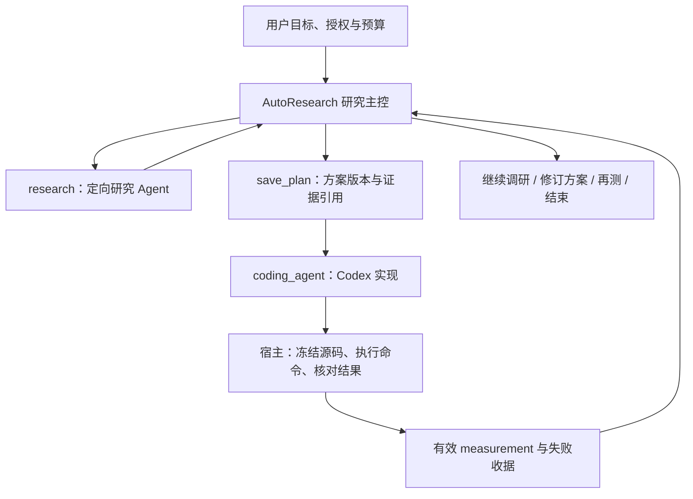

# 08｜Auto Research：把实测反馈送回研究决策

> 研究模型选方向，编码 Agent 实现，宿主提供可追溯测量。

[上一章](07-recovery.md) · [课程首页](README.md) · [下一章](09-parallel-research.md)

连续的设计故事见[项目学习手记第十节](../index.md#auto-research)（[网站阅读](https://prossiblezero.github.io/researchagent/#auto-research)）；本章沿着接口和源码展开。

## 问题：写出研究报告之后，怎样验证提出的方法？

普通研究 Agent 的交付主要是有证据的答案。Auto Research 则围绕更长的目标：读原文、保存假设和方案、委派代码、运行比较，再根据实际反馈决定继续或结束。

因此这里有两层循环：内层 `ResearchAgent.run()` 完成一次定向研究；外层 `AutoResearch.execute()` 管理整个研究目标和多次委派。Codex 自己也有编码循环，但该能力属于接入的外部 Agent。

## 开源启发与本项目的设计

本节于2026-10-13补充，将已有调研记录与当前实现集中对应。Auto Research 外层循环主要参考 **Microsoft RD-Agent** 和 **Sakana AI-Scientist**；前置的研究简报参考 **LangChain Open Deep Research**。历史来源分别记录在[V4设计](../auto-research-v4-redesign-20260929.md)与[V1设计](../v1.md)，下面链接指向当时阅读的固定提交。

|开源项目与阅读入口|借鉴的具体机制|本项目如何落地|
|---|---|---|
|[RD-Agent：RDLoop](https://github.com/microsoft/RD-Agent/blob/484776c211e4fbbeef03e0ec00d6bbee7362a4f4/rdagent/components/workflow/rd_loop.py)|从历史轨迹提出假设，将假设转成实验，再把编码、运行与反馈写回研究历史|`save_plan` 保存假设和方案版本；`assess_results` 比较实测；`decide()` 接收方案、测量和反馈，选择补调研、改方法或继续实验|
|[AI-Scientist：perform_experiments.py](https://github.com/SakanaAI/AI-Scientist/blob/1de1dbc1f4ee2c5f61e9c94348d55eb51d7fa2eb/ai_scientist/perform_experiments.py)|把 idea、baseline 和运行上限交给 coder，执行代码，读取结构化结果并回传|`CodingTool` 接收方案与任务；研究模型按需调用编码 Agent；宿主执行 baseline/candidate/ablation 命令，将结果文件、退出码与测量送回主控|
|[Open Deep Research：deep_researcher.py](https://github.com/langchain-ai/open_deep_research/blob/1b7d2e80db9faa586165c60e09096dbbfd483a64/src/open_deep_research/deep_researcher.py)|结合对话澄清目标，形成后续研究所用的 research brief|工作台的 `route_intent()` 结合会话生成 `brief` 和 `assumptions`；Auto Research 将简报、用户目标和预算放进每轮决策概览|

本项目围绕本地科研工作台，把上述思路组织成三项具体设计：

1. **研究主控管理方向，编码 Agent 完成实现。** 主控维护原文证据、基线、假设、方法和验证方案，再用 `plan_version` 交接给编码工具。它可以读取已有代码直接实验，也可以根据结果回到文献调研。入口是 [AutoResearch](../../research_agent/auto_research.py) 的 `execute()`、`decide()` 和 `dispatch()`。
2. **实验结果绑定实际执行和方案版本。** [CodingTool](../../research_agent/coding_tool.py) 保存源码快照、命令、结果文件与执行收据；主控按数据、配置和指标组织比较，[ResearchRecords](../../research_agent/research_records.py) 归档实验版本与报告。这样可以从一个结果找到对应方案和实现，也能安排针对模块的消融。
3. **长研究采用持久任务和反馈摘要。** 编码与子研究运行时，主控保存任务 ID 并让出 worker；`tick()` 在子任务结束后恢复调度。下一轮决策同时读取最近测量、评估与执行失败摘要，继续使用之前取得的实验反馈。

读代码时可以沿这条链走一遍：`route_intent → AutoResearch.decide → save_plan → CodingTool.submit/execute → measurements → assess_results → 下一次 decide`。已有代码的复测可从 `run_experiments` 直接进入执行阶段。下方流程图和各节分别展开这些接口。

扩展调研可从用户提供的 [Awesome-Auto-Research-Tools](https://github.com/handsome-rich/Awesome-Auto-Research-Tools/tree/main) 查找项目；本节的设计对应以上三个已有固定来源。

## 三个角色与信任边界



不是每次必须走完所有框。已有代码可直接运行；缺原文可继续读取；假设不成立也可以带负结果结束。选择由模型作出，权限、预算、合同与判定前提由程序检查。

## 主控实际有哪些工具？

工具定义在 [auto_research.py](../../research_agent/auto_research.py) 的 `TOOLS`：

| 工具 | 含义 | 关键约束 |
| --- | --- | --- |
| `prepare_project` | 宿主准备公开代码、数据与固定版本依赖 | 来源和版本留痕，限定准备次数及下载量 |
| `research` | 启动一次 web/local 子研究 | 消耗研究次数；返回子任务身份 |
| `research_parallel` | 委派两个独立子问题 | 一批恰好两项，原子创建，下一章详解 |
| `save_plan` | 保存 baseline、hypothesis、method、validation 等 | 证据绑定子任务 ID 和 E ID；状态为 HYPOTHESIS |
| `coding_agent` | 按已有方案委派 Codex | 要求有效方案版本和授权预算 |
| `run_experiments` | 对已有代码直接实测 | 不再启动编码，使用实验预算 |
| `assess_results` | 对有效实测结果做同条件比较 | 比较合同与基线匹配，不替代科学判断 |
| `inspect` | 查看历史任务、方案、项目文件和证据窗口 | 返回范围与读取进度，不能把目录当正文 |
| `finish_research` | 交付总结与限制 | 区分 reported / goal_met / blocked / budget_exhausted |

当前默认总预算包括 40 次决策、8 次子研究、4 次编码委派，以及编码时间/token、实验时间、实验模型调用等独立额度。准确默认值和上下界读 `DEFAULT_BUDGET`、`LIMITS`；示例中的预算不是费用上限，也不是保证一定耗尽。

`coding_agent` 只做代码实现时可以省略 `commands` 或传 `[]`，之后用 `run_experiments` 实测；后者仍要求至少一个命令。控制器可见的工具参数不再提供编码时间/token，由宿主在授权剩余额度内分配；旧请求仍按原额度恢复。编码工具上下文中的单次工具输出限制为4,000 token，大数据在本地计算并输出摘要，完整输入和预测保留在工作目录。参数错误会指出缺失/未知字段，`script` 必须是实际 `.py` 相对路径，任务说明写入 `task`。查看目录用 `inspect(kind=files)`，读文件正文用 `inspect(kind=file)`。

宿主默认分配当前剩余编码额度，单次最多 7200 秒、200 万累计输入（含缓存）加输出 token。底层接口仍接受 `seconds`、`token_budget`，用于兼容已有调用和持久化请求。完成后按可信收据扣减实耗，释放未用部分。同一调用重放沿用原分配，不重新付费。这里的编码预算不含研究主控消耗；同预算对照另用共享预算适配器统计主控与编码总和。

短任务的委派须保留用户要求的交付文件，已知评分命令时同次安排基线与候选测量。编码上下文附带与进程超时对应的 Unix 截止时间；这提供收尾提示，实际截止仍由宿主强制执行。编码 Agent 可以将有来源标注的开发集自测写入交付，但不能代替宿主测量。额外调参应保留最好已测源码，恢复后重新评分，避免最终代码与历史最高分不一致。这些是执行指引，不保证模型遵守，也不直接证明方法改善。

失败收据也先记账，再报告失败：`coding.usage_complete` 表示终结用量是否完整；完整时 `coding.tokens` 是已报告总用量，缺失或不一致时只保留 `reported_tokens` 下界，预留额度至少为原分配与已知下界的较大值。未知用量不是零，也不能证明没有超支。进程失败仍不会自动执行实验或重复调用编码模型。

## 长委派如何不阻塞主控？

源码阅读顺序：`execute()` → `decide()` → `dispatch()` → `yield_job()` → `tick()`。

1. 主控获得结构化工具决策并保存状态。
2. `research` 或 `coding_agent` 创建持久任务，记录 `waiting`。
3. 父任务变为 `queued / auto_waiting`，把 worker 让出。
4. `tick()` 只读任务状态；委派运行期间不反复调用模型询问“做完了吗”。
5. 终态结果进入主控消息，模型决定下一步。

当前 Auto Research 状态复用 `research_jobs` 和 `conversation_checkpoints`；方案保存在控制器状态中，并与研究成果档案衔接。早期设计文档里拟议的独立 `auto_research_runs` 表不能当作当前实际实现。

## CodingTool 的核心合同

先读 [coding_tool.py](../../research_agent/coding_tool.py) 的 `validate_request()`、`submit()`、`execute()`，再进入 [experiment_process.py](../../research_agent/experiment_process.py) 的进程和隔离逻辑。

一项实验命令明确包含 `name`、`role`、`script`、`args`、`result_path`、`seconds`。`role` 区分 baseline、candidate、ablation、diagnostic；每组写自己的结果文件，不能只在自然语言里说“做三组对比”。

宿主保存代码状态、变化与保护文件身份，按合同执行 Python 入口、记录退出码与产物，并在支持的指标合同下进一步核验预测和分数。任意脚本输出一段 JSON，不自动成为独立科学验证；自写 baseline 的公式、标签使用和评分逻辑仍需要审查。

`source_changes` 为空时不能声称完成了新方法实现。Codex 的 `summary` 是自述，即使含有漂亮数字，也不等于有效 `measurements`。

## 实现核验：分数提高之前先确认算对了

`assess_results` 会检查候选实现是否有同方案、同源码的宿主核验收据。没有、失败或源码变更后只有旧收据时，建议为 `verify_implementation`，下一步是补充/修复 `diagnostic` 并重新执行。数值达标情况保留，但不能据此 `finish_research(outcome=goal_met)`。先核验再跑长实验，可以更早发现实现偏离。

复用普通实验命令，设置 `role=diagnostic`。结果示例：

```json
{
  "metrics": {"examples": 2},
  "config": {"dataset": "hand_checked_tiny_cases"},
  "diagnostics": {
    "implementation_checks": {
      "baseline_equivalence": [
        {"name": "bonus_zero", "input": "关闭改进后的小数据结果向量",
         "reference": "冻结baseline在同一输入下的输出",
         "actual": [0.2, 0.8], "expected": [0.2, 0.8]}
      ],
      "calculation_examples": [
        {"name": "document_frequency", "input": "x在两个文档中分别出现3次和2次",
         "reference": "手算包含x的文档数为2，不能累计为5",
         "actual": 2, "expected": 2}
      ]
    }
  }
}
```

这里的数字只是格式示例；实际脚本必须调用候选代码计算 `actual`，并解释 `expected` 的独立来源，不能硬编码两边相同来过检查。基线等价组检查“关闭新机制后是否回到冻结基线”，计算组覆盖方法的关键中间量。

两组各需 1–64 例，每例含非空 `name/input/reference`，`actual/expected` 同为有限数值或等长非空数值列表（最多 128 项）。宿主用 `rel_tol=1e-9, abs_tol=1e-12` 逐项比较；布尔值、非有限数、缺组、空组、类型/长度不匹配均失败。结果里的自报 `passed` 不参与判定，宿主另存核验结论、失败样例与原始 JSON。

核验可以单独执行，绑定同一方案和源码快照。尽早创建核验脚本；增加/修改源码后需要重新核验、测量。相同源码的失败核验不能被另一条成功记录掩盖；同版本诊断异常、超时或未产出可读 JSON 也会阻止完成，需修复后重新核验。源码身份优先使用宿主保存的原文字节哈希，避免脱敏文本掩盖版本差异。普通诊断没有这个输出也可运行，但不算实现核验。诊断不套用数据集排名评分器；候选与基线仍需原有评分合同，不能通过更改结果 JSON 中的角色绕过。

这是可执行的样例核验，仍依赖项目提供的参考和覆盖范围，不是通用算法正确性证明。`scientific_effect_verified` 保持 `false`；核验通过后的分数提升，也不能自动归因于提出的新机制。已有历史评测按其当时的规则留存，新评测记录 `implementation_checks_required=true` 并检查这项门槛。

## 实验需要调用模型，但不能拿到密钥

项目支持两种宿主桥接方式：

| 方式 | 数据流 | 适用场景 |
| --- | --- | --- |
| JSONL 批次 | 脚本准备 `{id,messages}` → 宿主调用 → 响应 JSONL → 脚本读结果 | 输入可预先确定 |
| stdio 连续交互 | 脚本输出 `RESEARCH_MODEL_REQUEST` → 宿主响应 stdin → 脚本构造下一请求 | 记忆演化等依赖前次回答的实验 |

模型凭据由宿主管理；实验脚本拿到限定响应。请求和输出绑定收据与哈希，并共享父预算。调用重试和用量未知仍如实记录，不能只按脚本收到的成功响应数计成本。

详见[宿主模型接口](../v4-host-model-interface.md)。其中有历史“待合入”段落，当前参数支持情况以 `coding_tool.py` 校验函数为准。

## 执行隔离的实际能力

当前编码/实验面向本机 Windows 原生 Codex 环境。`clean_environment()` 清理子进程环境；文件规则限制写入工作目录，并拒绝已列出的宿主私有位置；数据和评分文件可冻结；进程层管理超时、取消和输出上限。

原生实现仍有 root read 等平台限制，不能称为虚拟机或完整只读白名单。对未知代码的安全边界应按实际平台合同说明，而不是用“有 sandbox”概括一切。

## 两种 V4 路径与成果版本

| 路径 | 主要入口 | 特点 |
| --- | --- | --- |
| 注册实验有限迭代 | `Experiments.prepare/submit/execute` | 面板显式提交、已注册评测合同、有界轮次 |
| Auto Research | `AutoResearch` + `CodingTool` | 模型选择研究、方案、编码或实测工具 |

成果层 [research_records.py](../../research_agent/research_records.py) 保存报告版本、实体关系、创新候选与实验版本。实验比较需要可比的配置、数据切分和指标；`HYPOTHESIS` 必须保留未验证性质。关系图基于 SQLite 的实体/关系记录，不能描述成已经实现通用 GraphRAG。

## 结束不只有“成功”

`completed` 是后台任务生命周期；`outcome=reported` 表示已经交付研究报告；`goal_met` 要求冻结的数值目标得到同条件有效宿主测量支持，且同方案、同源码的实现核验通过，并已保存对应评估。论文质量或全领域 SOTA 不能由一组项目内分数推出。

动手：读 [Auto Research 测试](../../tests/test_auto_research.py) 与[完整交付报告](../../evals/reports/v4-delivery-final-20261002/report.md)，寻找“代码执行失败”和“假设未获支持”各一个例子。沿 `plan_version → task_id → measurements → assessment` 追一次结果。普通学习无需重新启动付费编码实验。

## 把流程落到一组真实实验

以 SciFact 证据分类为例，先把“自动改进方法”拆成能交接和评分的内容：

| 环节 | 这个案例里具体是什么 | 对照代码时看什么 |
| --- | --- | --- |
| 基线与假设 | 词级／字符级 TF-IDF＋类别平衡逻辑回归；候选增加重叠、长度、否定及交互特征 | `save_plan` 的 baseline、hypothesis、method、validation |
| 编码交接 | 实现基线、候选和去除否定交互的消融，使用一致训练数据与评估方式 | `plan_version`、`CodingTool.submit()`、各命令的 role |
| 执行与评分 | train 训练、dev 评估；300 条论断展开 340 条文档记录，保存三组预测 | 源码快照、结果文件和 measurements |
| 分析与继续 | 比较哪组更好，决定是否保留特征、补实验或结束 | `assess_results`、下一轮 `decide()` 的比较与反馈 |

保存预测复算后，基线 macro-F1 为 **45.04%**，候选为 **49.00%**，增加 **3.96 个百分点**；消融组为 **48.49%**。这是读懂外层研究循环的一条具体线索：假设变成了代码，代码产生预测，评分再成为后续决策的输入。

HotpotQA 的另一项实验从正文 BM25（`k1=1.2, b=0.75`）取前两篇文档出发，候选调整正文计分并加入标题加权。在 64 题证据检索子集上，Recall@2 为 **59.38% → 65.63%**，增加 **6.25 个百分点**。候选同时存在文档频率计算偏离标准 BM25 的问题，原轮超出预算且报告未收尾；其算法得分与执行记录分别保留在[指标依据](../resume/researchagent-20261009-evidence.md)中。

这些数字比较的是任务基线和生成候选。学习时可以直接沿[学习手记中的案例](../index.md#auto-research-results)和指标依据阅读；有本地运行档案时，再检查预测、源码与评分的对应关系，无需重新调用模型。

## 面试表达与自测

日常控制器修改可先用[快速决策评测](../auto-research-fast-evaluation.md)检查历史状态下的下一步行为、预算与失败反馈，再决定是否投入完整研究实验。开发回放分数不能当作科研收益证明。

“我的 Auto Research 主要参考 RD-Agent 的假设—实验—反馈循环，以及 AI-Scientist 的编码执行与结果回传。我把它落地为研究主控、编码 Agent 和宿主执行器三个角色：主控读资料、形成方案，编码 Agent 实现，宿主运行对照与消融，实测结果再回到主控决定下一轮。方案、源码和结果按版本关联，长任务通过持久状态恢复。已生成的候选方案在 SciFact 开发集上将 macro-F1 从45.04%提升到49.00%，在 HotpotQA 64题证据检索子集上将 Recall@2 从59.38%提升到65.63%。”

上面两项成绩的算法基线、预测复算与运行记录见[简历证据中的 Auto Research 案例](../resume/researchagent-20261009-evidence.md)。

自测：为什么已有代码时用 `run_experiments`？测量可复算能否证明 baseline 实现正确？`completed`、`reported`、`goal_met` 分别说明什么？
