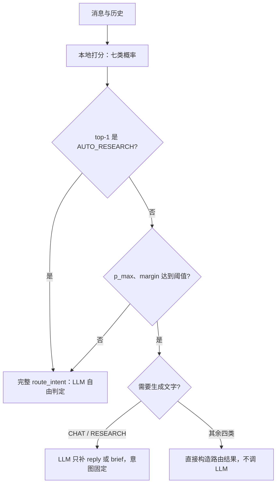

# 12｜专题：让小模型做选择，大模型做生成

> 分类问题不需要生成一段 JSON；给每个选项打分，就能得到可以校准的概率。

[上一章](11-interview.md) · [课程首页](README.md)

本章是 2026-10-18 补充的专题，对应[优化历程第 13 阶段](../optimization-history/13-decision-router.md)。读之前最好先看过[第 04 章](04-workbench.md)的七类意图。

## 问题：一次分类为什么要等十几秒？

原路由 `route_intent()` 每条消息调用一次远程 LLM，要求它输出 `intent`、`reply`、`brief`、`assumptions`、`effort` 五个字段。2026-10-12 的 210 题测试中，单题 p50 为 14.07 秒；9 道分类错误全部被判为 CHAT，但只有一个标签，看不出模型有多犹豫。

拆开看，这次调用其实做了两件事：

- **做选择**：七类意图选哪一个。这是分类问题。
- **做生成**：CHAT 要写回复，RESEARCH 要写研究简报。这才需要大模型。

LOCAL_QA、DOWNLOAD、BRAINSTORM、EXPERIMENT 四类入队时不需要任何文字，却和其他意图一样等待完整生成。如果“做选择”能交给一个快、能给出概率的本地模型，大模型只在需要写文字或需要谨慎判断时才出场，时延和成本都能降下来。

这种“只做选择、不生成文字”的模型常被称为决策模型，例如 TypeSafe 的 Jev。项目没有 Jev API，按 [LLM-as-Jev](https://arxiv.org/html/2610.02076v2) 论文的方法，用开源 Qwen3-0.6B 自己实现。

## 最小机制：选项 log-prob 打分

把七个意图写成编号选项，让模型在“最佳选项：[”后面续写，比较它续写 `1]`、`2]`……`7]` 的概率：

```text
system：判别规则 + [1] CHAT：…… [2] RESEARCH：…… …… [7] AUTO_RESEARCH：……
user：<state>{研究区元数据, 最近的会话历史}</state>
assistant：最佳选项：[          ← 预填，模型从这里开始“回答”

对 k = 1..7：score(k) = log P("k" | prompt) + log P("]" | prompt, "k")
p = softmax(score / T)        ← T 是在开发集上拟合的温度
```

和让模型“生成一个意图名”相比，有三点不同：

1. **不会解析失败。** 输出永远是七个数，不存在拼错标签、多写解释的问题。v2 测试中，同一个 0.6B 模型贪心生成意图名只有 15% 准确率。
2. **只需要一次 prefill。** prompt 编码一次，七个候选共享 KV cache 再各走一两步，0.6B 在 RTX 4080 SUPER 上的意图判定 p50 约 0.2 秒。
3. **有概率可用。** 可以算校准误差，可以设阈值，“不确定就回退”才有依据。

**选项顺序会带来偏差。** 模型可能天然偏爱排在前面或后面的编号。实现里分别用正序和逆序打分，按意图对齐后取概率平均，再做温度缩放。三种方案在开发集上比较后选定平均，不在测试集上选。

## 为什么还要 LoRA？

免训练打分在 0.6B 上只有 29.29%，开发集上正序打分的 macro-F1 只有 6%，几乎总选同一个位置。换成 4B 也只有 64.38%。七类意图的边界是这个产品自己定义的（比如“只调研、暂不实现”不算自动研究），通用模型不知道这些规则。

训练目标与推理打分保持一致：

```text
L = CE(softmax(score_1..7), gold)                  ← listwise 交叉熵，直接优化“选对”
  + λ · KL(p_base(·|prefix) ‖ p_lora(·|prefix))    ← 在 prompt 末尾几个位置锚定基座分布
```

只用意图数据微调，模型容易学到捷径：偏向某一类、压低不确定性、靠关键词判断。KL 锚定限制它偏离基座太远。选模时看开发集 macro-F1，并要求 ECE 不明显变差，不只看验证 loss；论文中观察到过 loss 一直下降、任务准确率反而下降的情况。

结果：0.6B + LoRA 在 v2 保留集上达到 96.43%，ECE 0.041，预测为 CHAT 的数量从免训练的 98 降到 16。本项目只跑了一个 seed，也没有单独做 KL 消融，不能把收益归因于 KL 项。

## 级联：什么时候交回大模型



两条规则值得记住：

- **低置信就回退。** 阈值来自开发集上的 risk–coverage 曲线：接受的样本错误率要低，覆盖率尽量高。打分超时、模型或提示哈希与校准时不一致、字段补全改了意图，也一律回退原路由。
- **AUTO_RESEARCH 总是交给 LLM。** 这是唯一会自动执行代码的意图。第一轮评测中，小模型容易把“授权了自动研究但没给主题”判成自动研究，而产品规则要求先澄清。自动研究一跑就是几分钟到几小时，路由多等几秒影响很小，所以这一类不走快速路径。

## 源码走读

| 想弄清什么 | 看哪里 |
| --- | --- |
| state 怎样构造、怎样防止历史里的伪造边界 | [decision_router.py](../../research_agent/decision_router.py) `state_text()`：保留最新用户消息，转义 `<`、`>`，超长时从最早历史开始丢 |
| 七个候选怎样共享一次 prefill | `option_logprobs()`：prefill 后复制并扩展 KV cache，逐 token 累加 log-prob；同一函数在训练时保留梯度 |
| 正序、逆序怎样对齐 | `OptionScorer.score()`：逆序 logits 反转后再取概率平均，最后做温度缩放 |
| 字段补全怎样防止改判 | `complete_route_fields()`：要求意图固定，结果经 `_parse_route` 校验，意图变了就报错回退 |
| 级联分支与回退原因 | `DecisionRouter.route()`：所有异常都回退 `route_intent()`，并通过 `on_decision` 写入 trace 的 `intent_decision` 事件 |
| 默认路径为什么不受影响 | `select_router()`：`ROUTER_MODE` 未设置或为 `llm` 时直接调用原 `route_intent()`；[workbench.py](../../research_agent/workbench.py) 的同步入口和 `pending_route` 后台重路由都经过它 |
| 校准身份 | `validate_config()` 与 `_score()`：配置中的权重、adapter、提示哈希必须与当前加载的一致 |

训练、校准与评测脚本分别是 [train_decision_router.py](../../evals/train_decision_router.py)、[calibrate_decision_router.py](../../evals/calibrate_decision_router.py)、[run_decision_router_eval.py](../../evals/run_decision_router_eval.py)；冻结的配置在 [config/decision_router.json](../../config/decision_router.json)。

## 评测是怎样设计的

这一专题最值得学的不是模型，而是评测纪律：

1. **看过结果的题不能再证明改进。** v1 的 210 题已经用来分析失败，只作回归集。先建 v2（训练 1,400 条、开发 70、保留测试 140），冻结之后才跑模型。
2. **超参数只在开发集上选。** 顺序方案、温度、阈值、学习率、检查点、要不要让 4B 进级联，都在 v2 开发集上决定。
3. **测试集每组只跑一次。** 失败、超时都留在分母里。
4. **改了就换新题。** 第一轮暴露 AUTO_RESEARCH 问题后改了规则，改动看过 v2 结果，所以另建 160 题的 v3（常规、自动研究边界、口语化三部分），编写者不能看 v2 测试题和错题。
5. **基线要能回答面试追问。** BGE-M3 + 逻辑回归回答“为什么不直接用 embedding 分类”；同一小模型生成意图名回答“为什么要打分”。

v3 的结论：

| 组 | 准确率 | 边界 35 题 | AUTO 误触发 | 完整路由 p50 | 远程请求 |
| --- | ---: | ---: | ---: | ---: | ---: |
| 原 LLM 路由 | 97.50% | 100% | 0/134 | 6.39s | 168 |
| 0.6B LoRA 纯本地 | 83.75% | 51.43% | 15/134 | 意图判定 0.20s | 0 |
| 级联 + AUTO 确认 | 98.75% | 100% | 0/134 | 3.99s | 98 |

级联比原路由多对 2 题，McNemar p=0.69，只能说持平。真正的收益是时延和成本，安全性来自 LLM 确认，而不是小模型本身。默认仍为 `ROUTER_MODE=llm`。

## 动手验证

单测使用 fake scorer 和 fake LLM，不下载模型：

```powershell
& $tutorialPython -B -m unittest discover -s tests -p 'test_decision_router.py' -v
```

重点读这几条用例：`test_four_direct_intents_never_call_llm`、`test_auto_always_uses_full_llm_confirmation`、`test_low_confidence_falls_back_identically`、`test_default_dispatch_is_exact_original_request`。完成标准：能说清哪种输入会走哪条分支，以及为什么默认模式下请求序列与原来逐字一致。

想在本机实际运行打分，需要按 [实现说明](../research/decision-router.md) 安装 `requirements-router.txt` 并下载固定版本的权重。权重和 LoRA adapter 都不在仓库里。

## 面试表达与自测

“原路由一次调用同时做分类和生成，慢，也没有置信度。我把‘做选择’拆给本地 0.6B 模型：对七个意图做 log-prob 打分，用 listwise 交叉熵加 KL 锚定做 LoRA，温度缩放后按置信度决定要不要交给 LLM；自动研究会执行代码，所以总是交给 LLM 确认。在冻结的 160 题新保留集上，准确率和原路由持平，误触发保持为 0，完整路由 p50 从 6.4 秒降到 4 秒，远程请求少了四成。纯本地版本在边界题上只有一半正确，所以没有直接替换。”

自测：

1. 为什么生成意图名的准确率远低于选项打分？
2. 选项顺序平均解决的是什么问题，代价是什么？
3. 验证 loss 下降时，为什么不能直接选这个检查点？
4. AUTO_RESEARCH 统一交 LLM 确认之后，为什么仍不能说“永不误触发”？
5. 级联的 p95 仍有 19 秒，长尾来自哪里？
